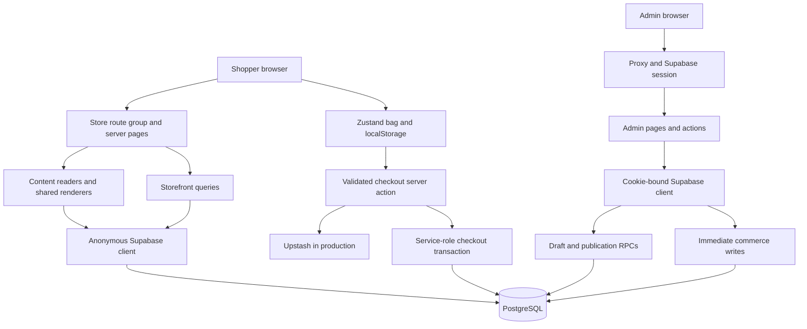

# Xenon architecture and behavior

Reviewed against the local working tree on **25 October 2026**. Start with [project context](project-context.md) for scope and [status](project-status.md) for verification limits.

## Stack and runtime

| Layer | Observed implementation |
| --- | --- |
| Application | Next.js **16.2.9** App Router; React **19.2.4**; TypeScript **5.9.3**, strict mode |
| Styling | Tailwind **3.4.19**, PostCSS, CSS variables in `app/globals.css` |
| UI | Local shadcn components, shadcn **4.11.0**, `@base-ui/react` **1.6.0**, Lucide icons |
| Database/auth/storage | Supabase JS **2.108.2**, Supabase SSR **0.12.0**, PostgreSQL SQL/RPC/RLS |
| Forms/validation | React Hook Form, resolver integration, Zod **4.4.3** |
| Cart | Zustand **5.0.14** and `localStorage` |
| Content | JSON revision payloads; Markdown rendered with `marked`, sanitized with DOMPurify |
| External services | Upstash Redis REST for production checkout limiting; optional Resend email |
| Checks | ESLint 9, TypeScript, Vitest **4.1.10** in Node; disposable PostgreSQL test script |

Versions above come from `package-lock.json`. Use npm and the committed lockfile. The documented import workflow needs Node 22+; this review ran Node 22.22.3. There is no runtime pin (`engines`/`.nvmrc`) in the reviewed setup. Motion, GSAP, Lenis and Embla are installed; their presence does not mean the active storefront uses them all.

Read relevant files in `node_modules/next/dist/docs/` before framework changes. This installation uses async request APIs (`params`, `searchParams`, `cookies`, `draftMode`) and `proxy.ts` rather than assuming older middleware conventions. Next.js route-group and component-boundary behavior was cross-checked through Context7 against [Next.js 16.2.9 source documentation](https://github.com/vercel/next.js/tree/v16.2.9/docs/01-app).

## Ownership and request flow

`app/layout.tsx` owns the document, global CSS, metadata defaults, icons and manifest. `app/(store)/layout.tsx` owns storefront header/footer, skip link, preview banner and content shell; it is `force-dynamic`. Individual product/journal files still contain static-params/revalidation hooks, so builds can issue database reads even though the storefront layout is dynamic. Do not infer full static generation or a 300-second stock cache from a child file alone.

`app/admin/layout.tsx` only adds noindex metadata and returns children. `app/admin/AdminLayout.tsx` is the explicitly rendered workspace wrapper used by admin pages. Adding navigation to the route layout as well would duplicate the shell. `proxy.ts` matches `/admin/:path*` and delegates session refresh/access redirects to `authMiddleware.ts`.

### Source responsibilities

| Location | Responsibility |
| --- | --- |
| `app/(store)/` | Public routes, page composition, checkout form/action |
| `components/content/` | Current homepage renderer, product rows, campaign/image rendering |
| `components/storefront/` | Header/footer, collection, filters, cards, product detail; also retained older homepage components |
| `components/cart/CartDrawer.tsx` | Bag UI, hydration and inventory refresh before checkout |
| `components/admin/` | Navigation, action form, labels/errors, delete confirmation, pagination |
| `components/ui/` | Base UI wrappers and local visual variants; shared by both surfaces |
| `app/admin/*/actions.ts` | Module mutations; `website/actions.ts` owns content revisions/media |
| `app/cart/actions.ts`, `app/newsletter/actions.ts` | Server actions; these folders do not define cart/newsletter page URLs |
| `lib/storefront.ts` | Public catalog queries and DB-to-view-model mapping |
| `lib/content/` | Content schemas, readers, compatibility importer and link validation |
| `lib/cart/` | Serializable item shape and browser store |
| `lib/adminSchemas.ts`, `lib/adminImageUploads.ts`, `lib/adminStorageCleanup.ts` | Catalog validation, common image upload checks and retention-aware cleanup |
| `lib/email/`, `lib/checkoutRateLimit.ts`, `lib/paymentMethods.ts` | External service and payment boundaries |
| `supabase/` | Base schema and manually applied additive SQL files |
| `scripts/`, `tests/` | Admin seeding, content import, checks and fixtures |

## Route map

All storefront file locations below are relative to `app/(store)/`. Route-group parentheses never appear in customer URLs.

| Public URL | Implementation / behavior |
| --- | --- |
| `/` | `page.tsx` → `getSiteContent()` → `HomeSections` |
| `/products` | `products/page.tsx` → shared `CollectionPage` |
| `/categories/[slug]` | Same collection/filter renderer, with category lookup and 404 handling |
| `/products/[slug]` | Server-loaded product, metadata/JSON-LD, variants/gallery client, related products, published size/returns content |
| `/checkout` | Active delivery zones and `CheckoutForm`; guest COD |
| `/payment/success` | Current successful checkout redirect; order received, pay on delivery |
| `/checkout/success` | Retained alternate COD confirmation route |
| `/payment/cancel` | Return-to-checkout screen; no gateway cancellation processing |
| `/account` | Explanation of guest shopping; no customer login |
| `/blog`, `/blog/[slug]` | Published journal listing/article via `lib/blog.ts` |
| `/return-policy`, `/shipping-policy`, `/privacy-policy`, `/terms`, `/size-guide` | Shared `PolicyPage` with published Markdown; unavailable pages return 404 |
| `/pages/[slug]` | Other information pages using the same renderer |
| `/sitemap.xml`, `/robots.txt` | Root `app/` route handlers; sitemap reads active/published data |

| Admin URL | Responsibility |
| --- | --- |
| `/admin/login` | Supabase password sign-in; active admin profile required |
| `/admin/dashboard` | Pending orders, low stock, unclassified audiences, unpublished documents |
| `/admin/products`, `/new`, `/[id]/edit` | Catalog, variants, stock, images, SEO and audience |
| `/admin/categories`, `/new`, `/[id]/edit` | Category CRUD, image, audience and order |
| `/admin/website` | Homepage/global settings or selected page/journal draft, preview, publish and history |
| `/admin/content` | Search/paginate pages and journal documents; links to website editor |
| `/admin/orders`, `/[id]`, `/[id]/invoice` | Order list, detail/status management, printable invoice |
| `/admin/promotions` | Create, enable/disable and delete promo codes |
| `/admin/delivery-zones` | Create, inline edit and delete district/city delivery zones |
| `/admin/newsletter` | Subscriber counts/search/list; no campaign sending or subscription-management UI |

In admin rows, suffixes are relative to that module (e.g. `/admin/products/new`). No `/admin` landing `page.tsx` exists. Legacy redirects are intentional: Banners/Homepage → `/admin/website`; Settings → `/admin/website?panel=footer`; Blog/Policies → `/admin/content` filtered by kind; their New/Edit URLs resolve to the revision editor. Legacy forms/actions remain in the tree, but are not the primary workspace.

| Handler | Contract |
| --- | --- |
| `GET /api/content-preview?key=…&revision=…` | Requires admin, saved matching revision; 401/404/409 on rejection; enables draft mode and redirects to the public route |
| `POST /api/content-preview/exit` | Clears draft mode/target cookie and redirects home with 303 |
| `GET/POST /api/payhere/checkout`, `/api/payhere/notify` | HTTP **501** with disabled message; no payment side effects |

## Catalog, filters and cart

`lib/storefront.ts` exposes `ProductSummary`, `ProductDetail`, `CategorySummary`, and paginated query results. Pages load data on the server; interactive components receive serializable values. Product images, variants and categories are hydrated with batched queries. Active products and active variants control availability; a product with no in-stock variant still has a sold-out presentation.

Collection URL state: `q`, `category`, `gender`, `color`, `size`, `minPrice`, `maxPrice`, `sort`, `page`; `tag` is also accepted for the New Arrivals title. `sort` supports newest/price ascending/price descending. Collection size is 24. Filters update URLs with `router.replace`, reset pagination after a filter change, and debounce search for 350ms. Category-route changes adjust the pathname. **`tag=new` currently labels a newest-sorted collection; it does not apply a separate new-product eligibility rule.**

Audience filtering uses `women`/`men` plus `unisex`, never name/image inference. Null audience is visible in All Products. The header only shows audience-specific entries when matching active products exist. Filter options come from `storefront_filter_options` with a compatibility fallback for missing RPCs.

Cards show product-level sale/base price. Purchase price precedence is **variant price → product sale price → base price**. Exactly one in-stock variant enables direct Quick Add; multiple options open a selection dialog loaded by `getQuickAddProduct`. Missing size normalizes to `Free Size`. The admin action currently materializes a blank variant price as base price; see the status ledger before changing price presentation.

`useCart` persists `CartItem[]` under **`xenon-cart`**, keyed/merged by `variantId`. It validates stored shape, tolerates corrupt/unavailable storage, and caps quantities against known stock. It is not a server cart or inventory reservation. `validateCartItemsAction` merges duplicate requests, refreshes actual prices/stock, removes unavailable variants and returns notices. Failed validation must preserve the user's current bag. Drawer and checkout call this boundary before continuing.

## Guest checkout and order lifecycle

1. Checkout loads active delivery zones. Full name, phone, address line 1, city, district and nonempty items are required. Email, postal code, second address and note are optional. The district form value is a **delivery-zone UUID**, not a district string.
2. Client validation uses React Hook Form/Zod. Delivery quote and promo actions supply provisional totals; the server never trusts a client total. Checkout guards repeat submission before inventory validation and releases pending controls in `finally`; thrown requests preserve input and the bag, and ambiguous order status asks the shopper to contact the store. A promo estimate is valid only for its normalized code and quoted subtotal.
3. `submitCheckoutAction` consumes an attempt before input parsing. The limiter allows five attempts per 60 seconds per hashed IP identifier. Production requires Upstash and blocks checkout if the limiter is missing/unavailable; development can use process memory. Deployment proxy headers must be trustworthy for the identifier to mean what is intended.
4. The action validates again and creates `XEN-YYYYMMDD-<random hex>`. It uses **`supabaseAdmin.rpc('checkout_transaction')`** because direct anon/authenticated execution is revoked.
5. SQL merges line requests, locks variants and an applicable promo, checks active products/stock/delivery/promo eligibility, recomputes prices, writes order/item snapshots, increments promo usage and deducts stock atomically. Failures roll back the transaction. Currency is LKR; database money uses `numeric(12,2)` and two-decimal rounding; current tax is zero. The current transaction uses a zone's configured delivery fee, not its unused free-delivery fields.
6. Optional order email is attempted after successful order creation. Missing email/provider or delivery failure does not roll back the order. The browser clears the bag only on action success and follows `/payment/success?order=…`.

Initial order/payment statuses are `pending`. Admin order transitions are: pending → confirmed or cancelled; confirmed → processing or cancelled; processing → shipped or cancelled; shipped → delivered. Same-state saves are accepted. Delivered/cancelled are terminal in the action. The UI exposes payment statuses pending/paid/failed/refunded independently; SQL has some broader legacy values, so do not build options solely from database enums/checks.

Cancellation uses `release_order_stock`, which checks authorization, locks the order, and restores existing variant quantities at most once using `stock_released_at`. It is allowed for pending/confirmed/processing/already-cancelled orders. Product deletion can null historic item references while preserving item snapshots; it does not recreate deleted variants on release. No automated abandonment expiry worker or general order-idempotency key is implemented.

## Website content lifecycle

`content_documents` identifies `site`, `page:<slug>`, and `journal:<slug>` with separate draft/published revision pointers. `content_revisions` contains versioned JSON payloads and author/publication timestamps. Zod schemas in `lib/content/schema.ts` are the UI/action contract.

The site payload contains navigation, announcement, footer, newsletter configuration and ordered sections. Six supported layouts: **hero, campaign, products, categories, occasions, story**. Products can come from newest/featured/category/manual selections. Manual product/category selections retain their chosen order; an empty manual selection stays empty. New sections start hidden. Payload version is 1; at most one enabled hero is allowed. Pages/journal use title, Markdown body, excerpt, image and SEO fields.

`WebsiteEditor` tracks local unsaved state, saved revision, published revision and previewed revision separately. Save creates a revision through `save_content_draft(expected)`. The expected draft pointer detects conflicting edits. Preview targets the saved revision, uses the **same public routes/renderers**, and keeps other documents published. An iframe checks `data-content-preview` against that revision before enabling Publish; this is a UI workflow guard, not a server-side record that a human reviewed it.

Publishing revalidates payloads, complete link labels/destinations, supported internal destinations, selected active catalog entries, campaign heading/image, and nonempty page content. `publish_content(expected)` moves the published pointer atomically only when the draft still matches. It invalidates the root layout and sitemap. Restore copies a historical payload into a **new draft**; it never rewinds catalog or orders.

Preview requires an active admin session plus draft mode. The target cookie (`xenon-content-preview`) is HTTP-only, SameSite Lax, secure on HTTPS. Public readers use the published revision; RLS restricts anonymous revision payload access to the current published pointer. Preview is private/no-store and noindex. Preserve the DOM revision marker if redesigning the storefront wrapper.

Compatibility readers use legacy tables only before initialization/missing schema, not to replace deliberately empty/hidden published content. `has_site_document` prevents hidden data from accidentally resurfacing through legacy fallback. After import, database triggers reject mutations to legacy banners/homepage/settings/policy/blog tables.

## Auth and data boundaries

| Client / check | Intended use |
| --- | --- |
| `lib/supabasePublic.ts` | Anonymous catalog/published reads; no persisted auth; 3.5-second fetch timeout |
| `lib/supabaseServer.ts` | Per-request cookie/session client; preserves RLS for admin/guest read paths |
| `lib/supabaseAdmin.ts` | Server-only service role for controlled guest checkout/newsletter; never import into client UI |
| `lib/supabaseClient.ts` | Browser client utility currently without static local consumers |
| `authMiddleware.ts` | Refresh cookies and redirect protected admin navigation |
| `requireAdmin`, `is_active_admin()` | Application/SQL checks for authenticated active admin profile |

Supabase service-role authorization bypasses RLS, so validation in privileged actions is essential. This separation agrees with [Supabase's RLS guidance](https://supabase.com/docs/guides/database/postgres/row-level-security). Session clients use the user's identity. Existing SQL/profile checks do not distinguish feature access between owner/admin/manager. Some older module actions rely on RLS rather than explicitly calling `requireAdmin`; do not assume the proxy alone protects a mutation.

There is one store, not a tenant model. No customer-account tables/session journey are wired. Server actions return validation/status data or redirects; their contracts vary by module, and are not universally one generic response shape.

## Persistence and media

| Tables | Meaning and invariants |
| --- | --- |
| `categories`, `products` | Unique slugs; product SKU; one optional category; active/draft/archive status; product-level price checks; audience added by content migration |
| `product_variants`, `product_images` | Unique SKU and normalized color/size combination; nonnegative stock; at most one primary image per product |
| `orders`, `order_items` | Customer/delivery/payment/order state and immutable-at-purchase item name/SKU/variant/price snapshots |
| `promo_codes`, `delivery_zones` | Code eligibility/usage and normalized district/city delivery settings |
| `payment_transactions` | Retained future gateway storage; not evidence of an enabled gateway |
| `newsletter_subscribers` | Case-insensitive email uniqueness; active/unsubscribed status; admin read access |
| `admin_profiles` | Auth user reference, active flag, owner/admin/manager label |
| `content_documents`, `content_revisions` | Document identity, checked revision references, retained publication history |
| `banners`, `homepage_sections`, `homepage_section_items`, `site_settings`, `blog_posts`, `policy_pages` | Legacy content/import compatibility; write-guarded after site import |

Product create/update uses `admin_upsert_product_v2` with a complete ordered image manifest and original gallery snapshot. It reuses the original product/variant RPC inside the same transaction, preserves retained image IDs, reconciles replacements/removal/order and rejects stale galleries. The original append-only RPC remains compatible. Existing variant IDs matter: removed variants are deleted, potentially nulling historical references. See [product image management](product-image-management.md) for the full contract.

Common active uploads allow JPEG/PNG/WebP up to **5 MiB per image**; product submissions allow at most five new/replacement files and 9 MiB combined beneath the 10 MB Server Action limit. Existing images do not count toward the file limit. Storage bucket limits/types differ from these application checks; broader bucket settings do not expand the UI contract.

Media buckets: `product-images`, `category-images`, `banner-images`, and retained legacy `blog-images`. Website images use immutable `website/<uuid>-…` names in `banner-images`. `retained_content_assets` and a `storage.objects` trigger protect any image referenced by retained revisions, including historical drafts, from delete/rename. Cleanup must keep assets when retention checks fail. History is not pruned automatically.

`ContentImage`/`CampaignPicture` handle desktop/mobile sources and focal positions; `StoreImage` handles product imagery. They retry the same source without optimization before showing unavailable imagery. `next.config.ts` permits Supabase public-storage hosts and Unsplash for optimized images. Arbitrary HTTPS content images can be rendered directly; do not broaden optimization hosts without a reason.

## Configuration, scripts and operations

Required app settings: `NEXT_PUBLIC_SUPABASE_URL`, `NEXT_PUBLIC_SUPABASE_ANON_KEY`, and server-only `SUPABASE_SERVICE_ROLE_KEY`. `NEXT_PUBLIC_SITE_URL` sets metadata/absolute links (fallback localhost). Production checkout additionally requires `UPSTASH_REDIS_REST_URL` and `UPSTASH_REDIS_REST_TOKEN`. Optional email uses `RESEND_API_KEY`, `RESEND_FROM_EMAIL`, and support-address configuration. `SEED_ADMIN_*` is for the explicit seed task. PayHere merchant settings are future-only and unused by current checkout.

`subscribeToNewsletter` validates and lowercases email, treats its honeypot as a no-op, inserts/reactivates a subscriber through the service role, and attempts a welcome email. Subscriber persistence, not email delivery, determines success. No queue, campaign integration or shopper unsubscribe flow is present.

SQL is manually ordered; there is no `supabase/migrations/` ledger. For fresh setup, follow the existing [rollout guide](website-editor-rollout.md): base schema, newsletter, content management; base schema already contains the checkout fix. Existing installations need applicable commerce upgrades before content migration/import. `content-management.sql` also replaces `admin_upsert_product` with the audience-aware version: do not overwrite it afterward with the older product SQL. Apply `product-image-management.sql` after content management for the versioned gallery RPC, cleanup reservations and stronger reference guards. Reapply the gallery migration if the content migration is reapplied later. Search indexes are a separate optional SQL file. `homepage-content.sql` is legacy seed material, not a post-import deployment step.

`content:import` defaults to dry-run, validates paginated legacy data, handles canonical policy aliases, skips existing documents on apply, imports pages first and site last. `seed:admin` creates/reuses an Auth user and upserts an active owner profile. Both can touch real configured services when applied; they are not ordinary UI checks. `setup.sh` installs/regenerates components and should not be used to inspect this established project.

README documents a Namecheap VPS + PM2 + Nginx deployment approach. No CI workflow, Dockerfile, infrastructure definition, health endpoint, or deployment verification was found in this review. This is a documented target, not evidence of the actual host. No deployment or database changes were performed for this documentation task.

## Redesign interaction boundaries

The shared font is loaded locally in `app/layout.tsx`; tokens and compatibility aliases live in `app/globals.css`. `BrandLogo` references the original PNG artwork with a cropped SVG viewport, leaving source images intact. Modal/sheet primitives use Base UI render/finalFocus APIs. Product filters retain URL state and a stable component instance while the filter sheet is open. Product rows page by four cards using native scroll, arranged 2×2 on phones.

`MutationForm` uses action results and pending state for promotion and delivery edits/deletes. Those server actions validate IDs, enforce active-admin access, and check actual returned rows before announcing success. Operational changes remain immediate. Preview entry and exit use relative redirects to retain the browser origin behind local/reverse proxies; draft cookies and revision verification remain intact.

Product image cleanup is queued in the same transaction as gallery detachment. New uploads reserve leased cleanup records before Storage calls; caught failures release them for retry. Storage API deletion is confirmed against metadata and guarded by a transaction mutex, reference checks across current/retained/legacy data, and deleted-key tombstones. No worker is installed: later saves or an explicit retry drain eligible work. See the feature guide for the serial-administration tradeoff, 30-minute lease and recovery limits.
